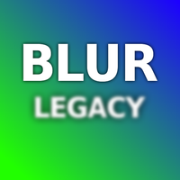

# Blur Legacy

Configurable menu blur for Minecraft 1.7.10, based on [Blur](https://github.com/tterrag1098/Blur) with features from [Blur Plus](https://github.com/Motschen/Blur).




[](https://discord.gg/xAWCqGrguG)
[](https://github.com/AngelicIndustries/BlurLegacy/releases)

<!-- Not published yet
[](https://www.curseforge.com/minecraft/mc-mods/blur-legacy)
[](https://modrinth.com/mod/blur-legacy)
[](https://www.mcmod.cn/class/PROJECT_ID.html)
[](https://67minecraft.com/mod/blur-legacy)
[](https://maven.angelic.industries/#/releases/industries/angelic/blur/BlurLegacy)
-->

## Features

* Adjustable blur with smooth opening and closing transitions.
* Separate gradient colors, opacity, rotation and optional rainbow mode.
* Screen categories, exclusions and a screen-name display for configuring modded menus.
* Optional title panorama blur and reduced blur behind inventories.
* Independent shader passes with automatic downsampling.

Configure through **Mods > Blur Legacy > Config** or `config/blur.cfg`. Existing Blur settings are retained. Replaces the original Blur jar; both use mod ID `blur`.

## Dependencies

* [UniMixins](https://github.com/LegacyModdingMC/UniMixins) [](https://www.curseforge.com/minecraft/mc-mods/unimixins) [](https://modrinth.com/mod/unimixins/versions) [](https://github.com/LegacyModdingMC/UniMixins/releases)

## Building

```sh
./gradlew build
```

## Credits

* [tterrag](https://github.com/tterrag1098/Blur/tree/1.7.10) for Blur.
* [Motschen and contributors](https://github.com/Motschen/Blur), including amiralimollaei, for Blur Plus's features and animation behavior.
* [Polyfrost](https://github.com/Polyfrost/Blur/tree/ornithe-1.8.9) for the legacy rendering and downsampling approach.
* [QaBns](https://github.com/QaBns/Blur/tree/1.7.10) for fixes to the original 1.7.10 version.
* The [GTNH buildscript](https://github.com/GTNewHorizons/ExampleMod1.7.10), Forge and MCP teams.

## License

[MIT](LICENSE).

## Buy me some creatine

* [ko-fi.com](https://ko-fi.com/jackisasubtlejoke)
* Monero: `893tQ56jWt7czBsqAGPq8J5BDnYVCg2tvKpvwTcMY1LS79iDabopdxoUzNLEZtRTH4ewAcKLJ4DM4V41fvrJGHgeKArxwmJ`

<br>


